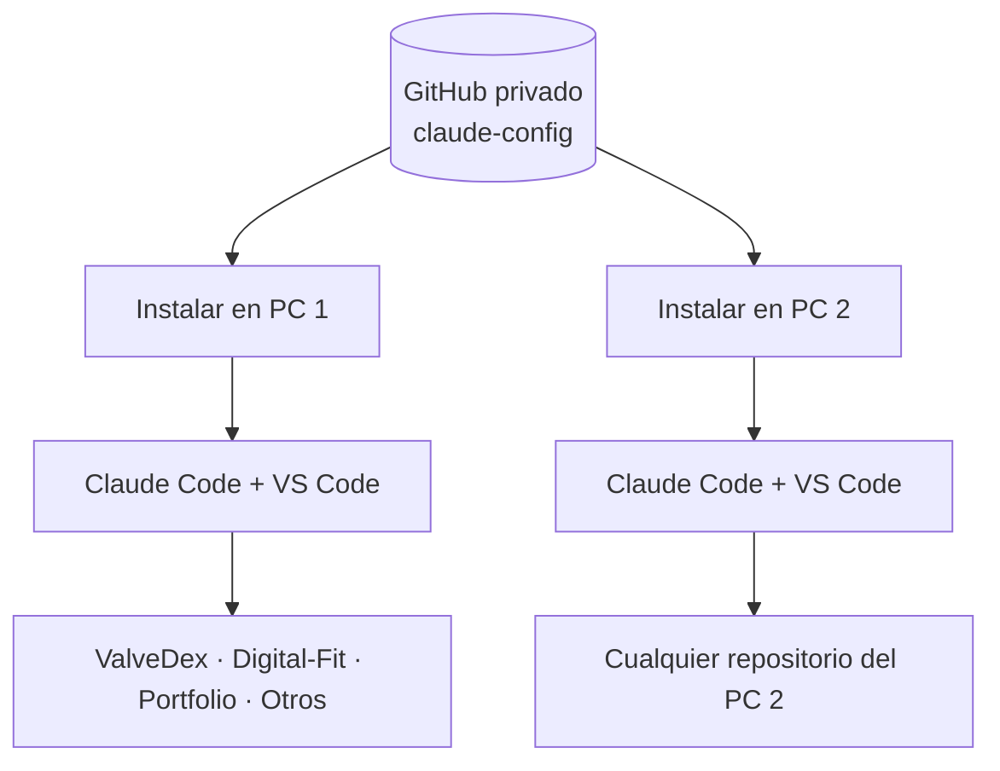

<div align="center">

# ⚡ Claude Config Portable

### Un solo kit. Todos tus proyectos. Cualquier PC.

**Plugins, skills, automatización y configuración de Claude Code en Windows y Visual Studio Code.**

[](https://www.microsoft.com/windows)
[](https://code.claude.com/docs/en/overview)
[](https://code.visualstudio.com/)
[](https://learn.microsoft.com/powershell/)

**[🚀 Empezar](#-inicio-rápido)** · **[🧩 Herramientas](#-qué-incluye)** · **[✨ Frontend](#-lenis-gsap-y-react-bits)** · **[💻 Otro PC](#-llevarlo-a-otro-pc)** · **[📚 Guías](#-documentación)**

</div>

---

> [!IMPORTANT]
> Este proyecto **no sustituye a Claude Code**. Es un kit reproducible de instalación y configuración. Lo ejecutas **una vez por ordenador** y los plugins/skills globales quedan disponibles en **todos tus repositorios**. Las credenciales y las memorias locales **no se suben a GitHub**.

## 🎯 ¿Qué soluciona?

Normalmente, clonar tu proyecto desde GitHub **no recupera** los plugins, skills y programas globales instalados en otro ordenador. Este repositorio conserva **el inventario, las reglas y los scripts** para reconstruir el entorno.



| 🌍 Global en el PC | 📦 Por proyecto | 🔒 Nunca en Git |
|---|---|---|
| Plugins, skills, reglas generales, utilidades de navegador | `package.json`, librerías como Lenis/GSAP, componentes React Bits, reglas específicas del repo | Claves API, cookies, tokens, sesión, base de datos local de Claude-Mem |

## 🚀 Inicio rápido

### 1. Requisitos

- Windows 10/11, **Git**, **Node.js 22.20+**, npm y **Claude Code CLI**.
- Visual Studio Code (recomendado) con extensión oficial de Claude Code.
- Acceso a internet para descargar plugins y skills.

Compruébalo desde PowerShell:

```powershell
git --version
node --version
npm --version
claude --version
code --version
```

Si falta Claude Code, sigue su [instalación oficial](https://code.claude.com/docs/en/setup).

### 2. Instala el kit

**Desde el ZIP:** descomprime la carpeta y ejecuta **`INSTALAR.cmd`**. No lo ejecutes dentro del ZIP.

**Desde PowerShell:** en la carpeta del kit:

```powershell
powershell.exe -NoProfile -ExecutionPolicy Bypass -File .\scripts\install.ps1
```

- Detecta plugins/skills ya instalados y evita repetir los que reconoce.
- Crea copia de seguridad de `~/.claude/settings.json` cuando exista.
- No reemplaza un `CLAUDE.md` global que ya tengas.
- Instala plugins en ámbito `user` para que estén disponibles en todos tus proyectos.
- Deja **Headroom, Caveman y Anti AI Slop desactivados** por defecto para reducir solapamientos.

> [!NOTE]
> Si prefieres un conjunto básico de plugins:
> `powershell.exe -NoProfile -ExecutionPolicy Bypass -File .\scripts\install.ps1 -Profile Core`

### 3. Verifica la instalación

```powershell
claude plugin list
npx skills ls -g
npx claude-mem doctor
```

Reinicia VS Code y Claude Code para cargar plugins o cambios en el `PATH`.

Si aparecen errores, cierra las sesiones abiertas y ejecuta **`REPARAR.cmd`**. También puedes consultar ` .local/report.json ` y ` .local/install.log `, que se generan localmente y no se publican.

📖 **[Guía detallada después de instalar](docs/PRIMEROS-PASOS.md)**

## 🧩 Qué incluye

### 🎨 Diseño y frontend

La base visual es **[Claude Code Frontend Skills](https://github.com/JaimeJunr/claude-code-frontend-skills)**, que coordina las distintas skills para que no compitan en una misma tarea.

| Skill/plugin | Uso principal |
|---|---|
| `frontend-stack` | Selecciona qué skill lidera una tarea de interfaz |
| `frontend-design` | Dirección visual de Anthropic |
| `impeccable` | Auditoría, accesibilidad, pulido de UI |
| `ui-ux-pro-max` | Sistemas de diseño, estilos y tipografía |
| `taste` | Landings y diseño más específico |
| `emil-design-eng` | Animaciones e interacciones |
| `imagegen-skills` | Image to Code y herramientas de imagen |
| `web-design-guidelines` | Revisión de buenas prácticas de interfaces |

### 🛠️ Desarrollo, memoria y automatización

| Área | Herramientas | Estado previsto |
|---|---|---|
| Planificación y calidad | Superpowers, Karpathy Skills, PonyTail, Grill Me | Global |
| Configuración | Claude Code Setup | Global |
| Memoria | Claude-Mem, Task Observer | Global; revisar proveedor de memoria |
| Navegador y pruebas | Playwright CLI, Agent Browser | CLI + skills globales |
| SEO | SEO Audit, AI SEO | Skills globales |
| Otras skills | Canvas Design, Skill Creator, Graphify, Find Skills | Disponibles globalmente según inventario |
| Referencias visuales | Awesome DESIGN.md | Consulta, no ejecución permanente |
| Opcionales sensibles | Headroom, Caveman, Anti AI Slop | Instalados, **desactivados** por defecto |
| Enrutador de modelos | OmniRoute | CLI instalada; conexión **no activada** |

El inventario exacto y las fuentes están en [`config/manifest.json`](config/manifest.json). Consulta cuándo utilizar cada componente en **[Guía de herramientas](docs/GUIA-HERRAMIENTAS.md)**.

## ✅ Después de instalar: configuración que sí debes revisar

No hace falta configurar manualmente **cada** plugin. Empieza por esto:

| Paso | Comando / lugar | ¿Obligatorio? |
|---|---|---|
| Comprobar plugins y skills | `claude plugin list` · `npx skills ls -g` | Recomendado |
| Comprobar memoria | `npx claude-mem doctor` | Solo si usarás Claude-Mem |
| Configurar memoria si falta | `npx claude-mem install` | Según diagnóstico/proveedor |
| Ver PonyTail | Dentro de Claude: `/plugin configure ponytail@ponytail` | Solo si indica opciones pendientes |
| Probar navegador | `playwright-cli --help` · `agent-browser --help` | Opcional |
| OmniRoute | Proveedores y credenciales propias | **No** hasta que quieras otro proveedor |
| Headroom | Runtime y hooks | **No** mientras esté desactivado |

> [!TIP]
> La configuración de PonyTail está pensada para guardar el registro de tareas **localmente** y dejar el webhook vacío. No añadas tokens ni claves a `config/defaults.json`.

## ✨ Lenis, GSAP y React Bits

Estas **no son skills de Claude**. Son librerías o componentes que se incorporan **únicamente a los proyectos frontend que las necesiten**.

| Recurso | Sirve para | En un proyecto con `package.json` |
|---|---|---|
| [Lenis](https://lenis.darkroom.engineering/) | Scroll suave | `npm install lenis` |
| [GSAP](https://gsap.com/) | Animaciones, scroll y transiciones | `npm install gsap` |
| [GSAP React](https://www.npmjs.com/package/@gsap/react) | Hooks de animación en React/Next.js | `npm install @gsap/react` |
| [React Bits](https://reactbits.dev/) | Componentes animados editables | Añadir los componentes elegidos |

**Para React o Next.js** puedes instalar los tres paquetes de animación juntos, desde la carpeta raíz de tu proyecto:

```powershell
npm install lenis gsap @gsap/react
```

O utilizar el script incluido en el kit para Lenis y GSAP. Desde **la carpeta del proyecto**, por ejemplo:

```powershell
powershell.exe -NoProfile -ExecutionPolicy Bypass -File "C:\ruta\a\claude-config\scripts\frontend-deps.ps1" -GSAP -Lenis -ReactGSAP
```

La instalación **no activa automáticamente** el scroll o las animaciones: hay que integrarlas en el código. En React Bits se incorpora el componente concreto, no un paquete completo obligatorio.

**[📘 Ver tutoriales paso a paso y ejemplos Next.js (Lenis, GSAP y React Bits)](docs/LIBRERIAS-FRONTEND.md)**

## 💻 Llevarlo a otro PC

En el nuevo ordenador, después de instalar Git, Node.js y Claude Code:

```powershell
git clone https://github.com/Manuelklk03/claude-config.git
cd claude-config
.\INSTALAR.cmd
```

Cuando quieras incorporar cambios del repositorio o actualizar herramientas:

```powershell
.\ACTUALIZAR.cmd
```

> [!WARNING]
> Git sincroniza **la receta de instalación**, no las sesiones de usuario, bases de memoria ni credenciales de proveedores externos. Cada ordenador necesita sus propias autenticaciones.

### ¿Y Claude Web?

Los plugins compatibles que añadas desde la **cuenta de Claude Web** pueden acompañarte en Claude Code al usar la misma cuenta. Pero las instalaciones locales de Windows, los hooks específicos y la memoria local **no se publican automáticamente en Claude Web**.

**[☁️ Guía de Claude Web](docs/CLAUDE-WEB.md)**

## 📁 Estructura

```text
claude-config/
├── INSTALAR.cmd            # Preparar un PC
├── REPARAR.cmd             # Reintentar componentes fallidos
├── ACTUALIZAR.cmd          # Actualizar el kit y los plugins
├── CLAUDE.md               # Reglas globales base
├── config/
│   ├── manifest.json       # Inventario de herramientas
│   └── defaults.json       # Predeterminados seguros
├── scripts/
│   ├── install.ps1
│   ├── repair.ps1
│   ├── check.ps1
│   ├── update.ps1
│   └── frontend-deps.ps1
└── docs/
    ├── PRIMEROS-PASOS.md
    ├── LIBRERIAS-FRONTEND.md
    ├── GUIA-HERRAMIENTAS.md
    ├── CLAUDE-WEB.md
    └── SOLUCIONAR-PROBLEMAS.md
```

<details>
<summary><strong>🔐 ¿Por qué no hay un script para publicar en GitHub en el repositorio?</strong></summary>

El script de publicación se guarda **solo en el equipo del propietario** y se excluye mediante `.gitignore`, como medida de organización. **La seguridad real la controla GitHub:** nadie puede hacer `push` sin permisos de escritura y autenticación, aunque conozca los comandos.

Para publicar documentación modificada, desde tu clon habitual puedes utilizar Git directamente:

```powershell
git add README.md docs/ .gitignore
git commit -m "docs: improve setup and frontend guides"
git push
```

</details>

<details>
<summary><strong>🧯 ¿Y si alguna instalación falla?</strong></summary>

1. Cierra Claude Code y VS Code si hay procesos Git bloqueados.
2. Ejecuta `REPARAR.cmd`.
3. Revisa `.local/report.json` y `.local/install.log`.
4. Consulta [Solucionar problemas](docs/SOLUCIONAR-PROBLEMAS.md).

No borres la carpeta `~/.claude` ni las bases locales de memoria para intentar reparar un marketplace.

</details>

## 📚 Documentación

| Documento | Contenido |
|---|---|
| **[Primeros pasos](docs/PRIMEROS-PASOS.md)** | Qué configurar después de instalar y cómo comprobar que funciona |
| **[Librerías frontend](docs/LIBRERIAS-FRONTEND.md)** | Lenis, GSAP, React Bits y ejemplos para Next.js |
| [Guía de herramientas](docs/GUIA-HERRAMIENTAS.md) | Cuándo usar cada plugin o skill |
| [Claude Web](docs/CLAUDE-WEB.md) | Qué funciona en la web y qué se sincroniza |
| [Solucionar problemas](docs/SOLUCIONAR-PROBLEMAS.md) | Diagnóstico y reparación |

---

<div align="center">

**Un entorno de Claude reproducible, sin duplicar configuraciones ni publicar datos privados.**

<sub>Proyecto personal de configuración · Herramientas de sus respectivos autores · Revisa cualquier plugin antes de permitirle ejecutar hooks o acceder a archivos.</sub>

</div>
