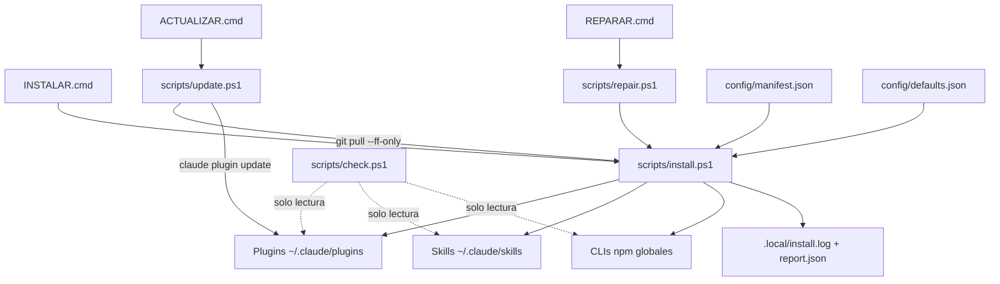

# 🏗️ Arquitectura del instalador

| Archivo | Función |
|---|---|
| `config/manifest.json` | Inventario: marketplaces, plugins (`principal`/`opcional`), skills, CLIs, referencias |
| `config/defaults.json` | Opciones seguras: proveedor de memoria, PonyTail, plugins que se desactivan al instalarse |
| `config/settings.global.template.json` | Referencia del bloque de plugins de `settings.json`. **No se copia**: los plugins se registran con la CLI |
| `scripts/install.ps1` | Instalación idempotente (perfiles `Complete` y `Core`) |
| `scripts/repair.ps1` | Reintenta lo pendiente y limpia solo clones temporales conocidos |
| `scripts/update.ps1` | `git pull --ff-only` + instalación + `claude plugin update` |
| `scripts/check.ps1` | Diagnóstico sin cambios |
| `scripts/frontend-deps.ps1` | Instala GSAP/Lenis en **un proyecto**, nunca global |

## Principios

1. **Detectar antes de instalar**: plugins por `installed_plugins.json`, skills por `~/.claude/skills/<nombre>/SKILL.md`, CLIs por el PATH (releído del registro al empezar).
2. **Verificar después**: un código de salida 0 no basta; se comprueba que el plugin, la skill o la CLI existen realmente.
3. **No sobrescribir**: `~/.claude/settings.json` se respalda en `.local/` y solo lo modifican los comandos oficiales de `claude plugin`. `~/.claude/CLAUDE.md` se crea solo si no existe. Las opciones de PonyTail solo se fijan si nunca se configuraron. Los plugins opcionales se desactivan solo cuando se instalan por primera vez.
4. **Errores comprensibles**: cada paso queda como `OK`, `SKIP`, `FAILED` o `PENDING` en `.local/report.json`; la salida completa va a `.local/install.log`.
5. **Nada de pago ni cuentas nuevas**: Claude-Mem se instala con `CLAUDE_MEM_ONLINE_OPTIN=false`.

## Parámetros de `install.ps1`

| Parámetro | Efecto |
|---|---|
| `-Profile Core` | Omite los plugins opcionales y sus marketplaces |
| `-SkipNpm`, `-SkipSkills`, `-SkipVSCode`, `-SkipClaudeMem`, `-SkipReferences` | Omiten esa parte |
| `-CleanStaging` | Borra solo los clones temporales `*.clone` conocidos de Claude-Mem y Headroom (lo usa `repair.ps1`) |
