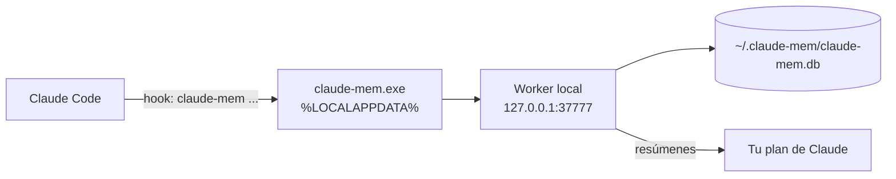

# 🧠 Claude-Mem sin servicios de pago

[Claude-Mem](https://github.com/thedotmack/claude-mem) guarda un resumen de tus sesiones en una base de datos **local** (`~/.claude-mem/claude-mem.db`) y lo inyecta en las sesiones siguientes del mismo proyecto.

> [!IMPORTANT]
> **No necesitas CMEM Pro ni una cuenta en cmem.ai.** La documentación oficial (README del paquete 14.0.1) lo indica: *"Prefer to skip the sign-in? Pass an explicit `--provider` flag, set `CLAUDE_MEM_ONLINE_OPTIN=false`, or run in CI/non-interactive shells — the installer completes without any account interaction."*

## Configuración recomendada (comprobada el 20/10/2026)

| Ajuste en `~/.claude-mem/settings.json` | Valor | Significado |
|---|---|---|
| `CLAUDE_MEM_PROVIDER` | `claude` | Los resúmenes se generan con **tu plan de Claude** (consume parte de su uso) |
| `CLAUDE_MEM_CLAUDE_AUTH_METHOD` | `subscription` | Usa el token de sesión de Claude Code; no hace falta API key |
| `CLAUDE_MEM_PRO_MEMORY_KEY` | vacío | Sin CMEM Pro |
| `CLAUDE_MEM_CLOUD_SYNC_*` | vacíos | Sin sincronización en la nube |

El aviso *"30 Day Free Trial…"* que aparece en el contexto de sesión es publicidad: ignorarlo no desactiva nada.

## Instalar o reparar sin iniciar sesión

`INSTALAR.cmd` lo hace solo cuando falta el lanzador. Manualmente, en PowerShell:

```powershell
$env:CLAUDE_MEM_ONLINE_OPTIN = 'false'
npx claude-mem install --provider claude
```

Después, **cierra VS Code por completo** (todas las ventanas) y vuelve a abrirlo.

> [!WARNING]
> Si tu `settings.json` de Claude-Mem ya tiene otro proveedor, `--provider claude` lo cambia. Sin `--provider`, en modo no interactivo se conserva el configurado. Las memorias (`claude-mem.db`) no se tocan en ningún caso.

## Cómo funcionan los hooks en Windows

Los hooks del plugin ejecutan el comando `claude-mem`, que es el lanzador `%LOCALAPPDATA%\claude-mem\bin\claude-mem.exe`. El instalador de Claude-Mem añade esa carpeta al **PATH de usuario**, pero los programas que ya estaban abiertos (VS Code, terminales) siguen con el PATH antiguo hasta que se reinician.



## Diagnóstico

```powershell
powershell.exe -NoProfile -ExecutionPolicy Bypass -File .\scripts\check.ps1
```

La sección **Claude-Mem** comprueba el lanzador, el PATH de usuario, si VS Code es más antiguo que el lanzador y el estado del worker. También puedes abrir <http://localhost:37777>.

### `npx claude-mem doctor` dice "Hook launcher ✗"

Es un **falso positivo** en Windows: `npx` pone su propio `claude-mem.cmd` (de la caché de npm) delante en el PATH, y `doctor` comprueba ese en lugar del lanzador real. El resto de comprobaciones de `doctor` sí son válidas. Comprobación real:

```powershell
& "$env:LOCALAPPDATA\claude-mem\bin\claude-mem.exe" --version   # debe mostrar un número (protocolo), p. ej. 1
```

No hace falta volver a ejecutar `npx claude-mem install` por este aviso.

### "Codex CLI: integration setup failed"

El instalador de Claude-Mem intenta integrar también Codex CLI. Si Codex no está instalado (no forma parte de este kit), ese paso falla sin afectar a Claude Code ni a Windsurf. No requiere reparación.

### Windsurf

Claude-Mem genera `.windsurf/rules/claude-mem-context.md` en los proyectos que abres con Windsurf. Es un archivo autogenerado: en este repositorio está en `.gitignore`.

## Límites

- Las memorias son **locales a cada PC**: no se sincronizan por Git (y no deben subirse).
- La sincronización en la nube (`cloud-sync`) y el observador de CMEM requieren cuenta de cmem.ai: **no se usan** en este kit.
- Con el proveedor `claude`, cada resumen consume uso de tu plan de Claude.
- La memoria empieza a inyectarse a partir de la segunda sesión en cada proyecto.
