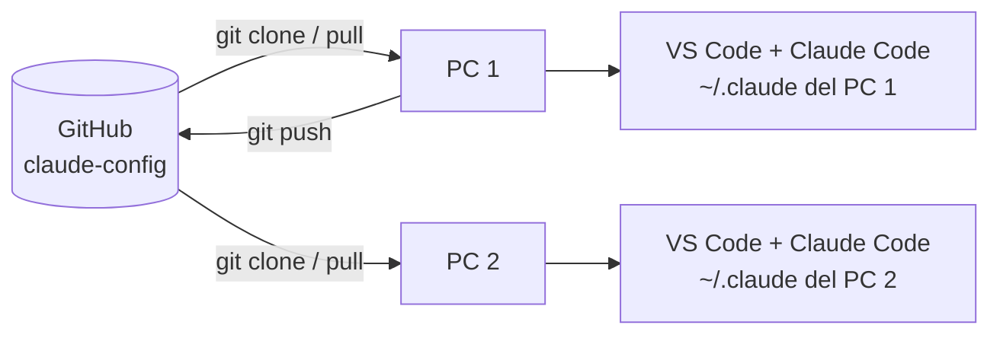

# 🔄 Otro ordenador, GitHub y actualizaciones

Git sincroniza **la receta** (manifiesto, scripts, reglas, documentación). Cada PC instala sus propios plugins, skills y autenticaciones a partir de ella.



## Migrar a un ordenador nuevo

1. Instala Git, Node.js 22.20+ y Claude Code (ver [Primeros pasos](PRIMEROS-PASOS.md)).
2. Inicia sesión en Claude Code (`claude`) y en GitHub (Git Credential Manager se abre al clonar un repo privado).
3. Clona e instala:

   ```powershell
   git clone https://github.com/Manuelklk03/claude-config.git "$HOME\Desktop\claude-config-universal"
   cd "$HOME\Desktop\claude-config-universal"
   .\INSTALAR.cmd
   ```

4. Cierra VS Code por completo, ábrelo y ejecuta `.\scripts\check.ps1`.

Lo que **no** viaja: memorias de Claude-Mem, sesiones, `~/.claude/settings.json` personal, credenciales de OmniRoute u otros proveedores. Las rutas con espacios (`C:\Users\TB Val 12`) están soportadas.

## Mantener dos ordenadores sincronizados

Regla simple: **pull antes de cambiar, push al terminar.**

```powershell
cd "$HOME\Desktop\claude-config-universal"
git pull --ff-only                 # traer cambios del otro PC
# ...editar manifiesto, docs o scripts...
git add -A
git status                         # revisar que no hay nada privado
git commit -m "docs: describe el cambio"
git push origin main
```

En el otro PC basta con `.\ACTUALIZAR.cmd` (hace `git pull --ff-only`, instala lo nuevo y actualiza los plugins).

### Si `git push` dice `rejected (non-fast-forward)`

El remoto tiene commits que tu PC no tiene (por ejemplo, editaste el README en GitHub). **No uses `--force`.**

```powershell
git fetch origin
git log --oneline main..origin/main   # que hay en remoto
git log --oneline origin/main..main   # que hay solo en local
git rebase origin/main                # reaplica tus commits encima
# si hay conflictos: edita los archivos, git add <archivo>, git rebase --continue
# para abandonar sin perder nada: git rebase --abort
git push origin main
```

Si tienes cambios sin confirmar, haz antes `git stash` y después `git stash pop`.

## Actualizar herramientas

| Acción | Comando |
|---|---|
| Kit + plugins | `.\ACTUALIZAR.cmd` |
| Reintentar lo que falló | `.\REPARAR.cmd` |
| Un plugin concreto | `claude plugin update <id>` (reinicia Claude Code después) |
| Skills globales | `npx skills update -g` |

## Añadir una herramienta nueva

1. Compruébala a mano en un PC: `claude plugin install <plugin>@<marketplace> --scope user` o `npx skills add <owner/repo> --skill <nombre> -g -a claude-code`.
2. Añádela a [`config/manifest.json`](../config/manifest.json):
   - plugin: su marketplace en `marketplaces` y el id en `plugins` (`stage`: `principal` u `opcional`);
   - skill: `{ "source", "skill", "purpose" }` en `skills`;
   - CLI de npm: `{ "pkg", "command", "purpose" }` en `npmGlobal`.
3. Si puede chocar con otras (hooks, proxies, estilos), márcala `opcional` y añádela a `optionalPluginsInstalledButDisabled` en [`config/defaults.json`](../config/defaults.json).
4. Documenta su uso en [Guía de herramientas](GUIA-HERRAMIENTAS.md), haz commit y push.

## Usar Claude Code en cualquier repositorio

Los plugins y skills están en `~/.claude` con alcance `user`: aparecen en **todos** los proyectos del PC, desde la terminal o desde VS Code. Cada repositorio puede añadir sus propias reglas en su `CLAUDE.md` y `.claude/settings.json`; el kit nunca los modifica.
